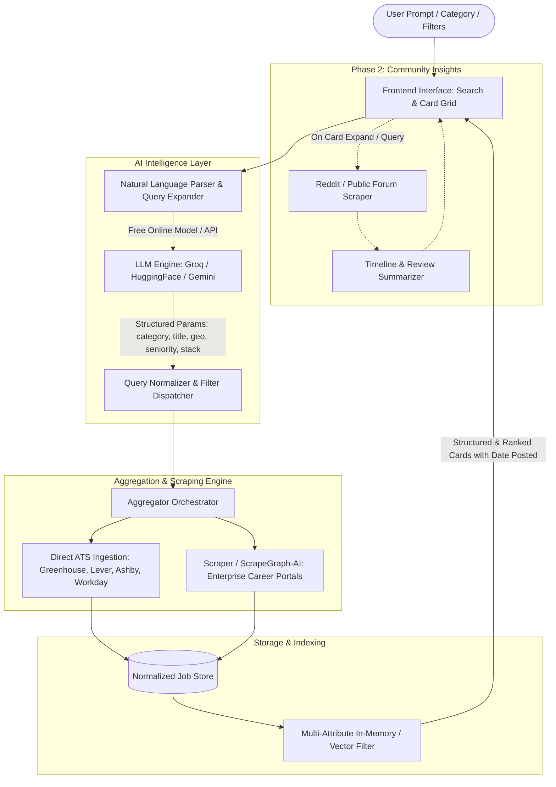

# Neural Map: Project Architecture & Logic

## Core Modules & Logic Flow

1. **User Interface (`frontend/` - Phase 3 Complete)**
   - [Header.tsx](file:///c:/Users/u1233270/Downloads/Personal%20Apps/Temporal%20Loom/frontend/src/components/Header.tsx): Live feed badge, indexed job count, saved jobs toggle.
   - [SearchBar.tsx](file:///c:/Users/u1233270/Downloads/Personal%20Apps/Temporal%20Loom/frontend/src/components/SearchBar.tsx): Omnibox conversational search (`/` shortcut), real-time NLP parsing badge, prompt chips.
   - [CategoryPills.tsx](file:///c:/Users/u1233270/Downloads/Personal%20Apps/Temporal%20Loom/frontend/src/components/CategoryPills.tsx): Category ribbon and 36 curated discovery track pills.
   - [FilterSidebar.tsx](file:///c:/Users/u1233270/Downloads/Personal%20Apps/Temporal%20Loom/frontend/src/components/FilterSidebar.tsx): Faceted sidebar for freshness (24h/7d/14d/30d), remote mode, country, domain, seniority, sorting.
   - [JobCard.tsx](file:///c:/Users/u1233270/Downloads/Personal%20Apps/Temporal%20Loom/frontend/src/components/JobCard.tsx): High-craft job cards with prominent posting dates (relative + exact), verified ATS apply CTA, bookmark toggle.
   - [JobDetailModal.tsx](file:///c:/Users/u1233270/Downloads/Personal%20Apps/Temporal%20Loom/frontend/src/components/JobDetailModal.tsx): Interactive job inspection modal with skill chips and verified ATS link.
   - [useBookmarks.ts](file:///c:/Users/u1233270/Downloads/Personal%20Apps/Temporal%20Loom/frontend/src/hooks/useBookmarks.ts): Persistent saved jobs in `localStorage`.

2. **NL Query Interpreter & Taxonomy (`backend/app/services/` & `api/`)**
   - [backend/app/services/llm_adapter.py](file:///c:/Users/u1233270/Downloads/Personal%20Apps/Temporal%20Loom/backend/app/services/llm_adapter.py): Multi-model LLM adapter (Groq Llama 3.3, Google Gemini Flash, OpenRouter) with `HeuristicQueryParser` regex fallback.
   - [backend/app/services/taxonomy.py](file:///c:/Users/u1233270/Downloads/Personal%20Apps/Temporal%20Loom/backend/app/services/taxonomy.py): Granular ontology with 6-way PM & Strategy split (`product`, `technical_product`, `product_ops`, `management_consulting`, `corporate_strategy`, `founders_office`), parent cluster resolution (`product_cluster`, `strategy_cluster`), and fast-path matching.
   - [backend/app/utils/classifier.py](file:///c:/Users/u1233270/Downloads/Personal%20Apps/Temporal%20Loom/backend/app/utils/classifier.py): Sub-0.1ms compiled regex classifier resolving `(category, seniority, track)` with employer consulting hints and priority collision resolution.
   - [backend/app/utils/query_cache.py](file:///c:/Users/u1233270/Downloads/Personal%20Apps/Temporal%20Loom/backend/app/utils/query_cache.py): In-memory LRU/TTL parsed query cache.
   - [backend/app/api/nlp.py](file:///c:/Users/u1233270/Downloads/Personal%20Apps/Temporal%20Loom/backend/app/api/nlp.py): Fast-path taxonomy match before LLM fallback in `POST /api/nlp/parse` and `POST /api/nlp/search`.
   - [backend/app/api/categories.py](file:///c:/Users/u1233270/Downloads/Personal%20Apps/Temporal%20Loom/backend/app/api/categories.py): `GET /api/categories`, `GET /api/categories/tracks` (with live job counts), and `GET /api/categories/clusters`.

3. **Aggregator & Custom Ingestion Engine (`backend/app/scrapers/` & `services/sync.py`)**
   - Direct ATS Connectors: [greenhouse.py](file:///c:/Users/u1233270/Downloads/Personal%20Apps/Temporal%20Loom/backend/app/scrapers/greenhouse.py), [lever.py](file:///c:/Users/u1233270/Downloads/Personal%20Apps/Temporal%20Loom/backend/app/scrapers/lever.py), [ashby.py](file:///c:/Users/u1233270/Downloads/Personal%20Apps/Temporal%20Loom/backend/app/scrapers/ashby.py).
   - Custom Portal Crawler: [custom_crawler.py](file:///c:/Users/u1233270/Downloads/Personal%20Apps/Temporal%20Loom/backend/app/scrapers/custom_crawler.py) (polite browser headers, HTML pre-processor & DOM block extractor).
   - LLM Portal Extractor: [llm_scraper.py](file:///c:/Users/u1233270/Downloads/Personal%20Apps/Temporal%20Loom/backend/app/scrapers/llm_scraper.py) (semantic normalization of unstructured custom portals with seed catalog [custom_portals.json](file:///c:/Users/u1233270/Downloads/Personal%20Apps/Temporal%20Loom/backend/app/data/custom_portals.json)).
   - [backend/app/services/sync.py](file:///c:/Users/u1233270/Downloads/Personal%20Apps/Temporal%20Loom/backend/app/services/sync.py): Bounded-concurrency background sync pipeline with 55 seed companies catalog and custom portal ingestion.
   - [backend/app/utils/date_parser.py](file:///c:/Users/u1233270/Downloads/Personal%20Apps/Temporal%20Loom/backend/app/utils/date_parser.py): Robust date parser supporting ISO 8601, epoch milliseconds, and relative timestamps.

4. **Normalized Job Storage (`backend/app/db/` & `models/`)**
   - [backend/app/models/job.py](file:///c:/Users/u1233270/Downloads/Personal%20Apps/Temporal%20Loom/backend/app/models/job.py): `JobItem` model with deterministic SHA-256 deduplication and UTC datetime enforcement.
   - [backend/app/db/database.py](file:///c:/Users/u1233270/Downloads/Personal%20Apps/Temporal%20Loom/backend/app/db/database.py): SQLite storage with composite indexes (`date_posted DESC`, `category`, `company`, `domain`, `country`), regional geographic expansion (e.g. Europe), and sorting.

5. **Community Insights (`backend/app/services/reddit.py`, `backend/app/api/insights.py`, & `frontend/`)**
   - [backend/app/services/reddit.py](file:///c:/Users/u1233270/Downloads/Personal%20Apps/Temporal%20Loom/backend/app/services/reddit.py): `RedditCommunityService` querying public Reddit `.json` search feeds with custom User-Agent headers, 24-hour in-memory TTL caching, benchmark consensus for top employers, and fallback synthesis.
   - [backend/app/api/insights.py](file:///c:/Users/u1233270/Downloads/Personal%20Apps/Temporal%20Loom/backend/app/api/insights.py): `GET /api/insights/company` providing turnaround estimates, interview round breakdowns, insider tips, and thread links.
   - [frontend/src/components/CommunityInsightsDrawer.tsx](file:///c:/Users/u1233270/Downloads/Personal%20Apps/Temporal%20Loom/frontend/src/components/CommunityInsightsDrawer.tsx): High-craft slide-over panel with turnaround highlight, hiring sentiment summary, stepped process roadmap, candidate tips, and authentic Reddit cards.
   - Integrated trigger buttons in [JobCard.tsx](file:///c:/Users/u1233270/Downloads/Personal%20Apps/Temporal%20Loom/frontend/src/components/JobCard.tsx) and [JobDetailModal.tsx](file:///c:/Users/u1233270/Downloads/Personal%20Apps/Temporal%20Loom/frontend/src/components/JobDetailModal.tsx).

6. **v2 Desktop-Grade Master-Detail Architecture (`frontend/`)**
   - **Column 1 (`NavRail.tsx`)**: Left collapsible navigation rail with quick counts (All, Saved, 24h Fresh), category badges, and faceted filter accordions.
   - **Column 2 (`MasterJobStream.tsx`)**: Omnibox search with `/` trigger, active filter chips, sort options, and high-density job cards with `J`/`K` keyboard cursor navigation.
   - **Column 3 (`JobInspectorPane.tsx`)**: Persistent right-side inspection pane with role summary, verified ATS apply CTA, and embedded tabbed Reddit community intel.

7. **Massive Multi-ATS Global Pipeline (200+ Firms)**
   - [backend/app/data/companies.json](file:///c:/Users/u1233270/Downloads/Personal%20Apps/Temporal%20Loom/backend/app/data/companies.json): Seed dataset of 200+ global industry leaders categorized by domain, region, and ATS connector type (Greenhouse, Lever, Ashby, SmartRecruiters, Workday).
   - [backend/app/services/sync.py](file:///c:/Users/u1233270/Downloads/Personal%20Apps/Temporal%20Loom/backend/app/services/sync.py): Bounded-concurrency async ingestion runner with rate-limit backoff, duplicate elimination, and batch insertion into SQLite.
   - [backend/app/db/database.py](file:///c:/Users/u1233270/Downloads/Personal%20Apps/Temporal%20Loom/backend/app/db/database.py): SQLite persistence layer with composite indexes for sub-50ms multi-attribute queries across thousands of active jobs.

8. **Indian Tech Startup & Unicorn Discovery Pipeline**
   - [backend/app/data/companies.json](file:///c:/Users/u1233270/Downloads/Personal%20Apps/Temporal%20Loom/backend/app/data/companies.json): Curated directory of 50+ verified Indian tech unicorns and startups (Paytm, Swiggy, Meesho, CRED, Groww, InMobi, Glance, Sarvam AI, Atlan, Zeta, HighRadius, Zenoti, Mindtickle, SigNoz, Druva, Kovai.co, etc.).
   - [backend/app/utils/classifier.py](file:///c:/Users/u1233270/Downloads/Personal%20Apps/Temporal%20Loom/backend/app/utils/classifier.py): Regional geographic mapping for all major Indian tech centers (Bengaluru, Hyderabad, Mumbai, Delhi NCR, Gurugram, Noida, Pune, Chennai, Ahmedabad) with ISO-2 code mapping (`IN`/`IND` -> `India`) and company-origin fallbacks.
   - [backend/app/scrapers/](file:///c:/Users/u1233270/Downloads/Personal%20Apps/Temporal%20Loom/backend/app/scrapers/): ATS connectors (Lever, Greenhouse, Ashby, SmartRecruiters) enriched with `company_hint` for deterministic country classification and verified direct listing links.

9. **Candidate Lead Capture & Referral Engine (`backend/app/api/leads.py` & `frontend/`)**
   - [backend/app/db/database.py](file:///c:/Users/u1233270/Downloads/Personal%20Apps/Temporal%20Loom/backend/app/db/database.py): SQLite `candidate_leads` schema for storing candidate profile submissions, target job IDs, CTC expectations, and referral status.
   - [backend/app/api/leads.py](file:///c:/Users/u1233270/Downloads/Personal%20Apps/Temporal%20Loom/backend/app/api/leads.py): `POST /api/leads/submit`, `GET /api/leads`, and `POST /api/leads/pitch` for candidate lead capture, referral pitch generation, and recruiter querying.
   - [frontend/src/components/LeadCaptureModal.tsx](file:///c:/Users/u1233270/Downloads/Personal%20Apps/Temporal%20Loom/frontend/src/components/LeadCaptureModal.tsx): Obsidian dark dialog with LinkedIn profile sync, YoE, CTC LPA numbers, Notice Period selector, and 1-click clipboard referral pitch copy.
   - [frontend/src/components/NavRail.tsx](file:///c:/Users/u1233270/Downloads/Personal%20Apps/Temporal%20Loom/frontend/src/components/NavRail.tsx): Dedicated "India Direct" toggle (🇮🇳 1.4k live count) and Indian Metro Tech Hub ribbon.
   - [frontend/src/utils/ctcFormatter.ts](file:///c:/Users/u1233270/Downloads/Personal%20Apps/Temporal%20Loom/frontend/src/utils/ctcFormatter.ts): High-fidelity INR CTC parser and calibrated compensation benchmark engine (₹ LPA).

10. **Indian Developer Community Intelligence & Verification (`backend/app/services/reddit.py` & `tests/`)**
    - [backend/app/services/reddit.py](file:///c:/Users/u1233270/Downloads/Personal%20Apps/Temporal%20Loom/backend/app/services/reddit.py): Regional routing to `r/developersIndia`, `r/IndianStartups`, and `r/IndiaTech` for Indian tech employers; benchmark consensus for Swiggy, CRED, Groww, Meesho, Razorpay, Atlan, Target India, and Thoughtworks.
    - [frontend/src/components/JobInspectorPane.tsx](file:///c:/Users/u1233270/Downloads/Personal%20Apps/Temporal%20Loom/frontend/src/components/JobInspectorPane.tsx): 5-stage Indian hiring roadmap (Online Assessment -> Machine Coding -> LLD/HLD -> Hiring Manager -> HR & Notice Period Buyout) and Community Hub source badge.
    - [tests/test_india_engine.py](file:///c:/Users/u1233270/Downloads/Personal%20Apps/Temporal%20Loom/tests/test_india_engine.py): Automated test suite verifying Indian catalog schemas, location and metro classifier, heuristic NLP parsing, sub-50ms query latency, and community intelligence routing.

11. **Milestone v5: Indian Career Repository & Batch Ingestion Pipeline**
    - `career_targets` Registry: SQLite table indexing 233+ companies (Startups, Unicorns, Conglomerates, Strategy Consulting), tracking direct career links, ATS connectors, scraping status, role tags, and scrape timestamps.
    - Reddit Discovery Engine ([backend/app/services/reddit_scanner.py](file:///c:/Users/u1233270/Downloads/Personal%20Apps/Temporal%20Loom/backend/app/services/reddit_scanner.py)): Autonomous mining of `r/developersIndia`, `r/IndianStartups`, `r/ProductManagement`, `r/consulting`, and `r/bangalore` with 24h SQLite TTL cache (`discovery_cache`), polite backoff, and HTTP 429 resilience.
    - Multi-ATS Discovery Prober ([backend/app/services/discovery_prober.py](file:///c:/Users/u1233270/Downloads/Personal%20Apps/Temporal%20Loom/backend/app/services/discovery_prober.py)): Regex candidate extraction, concurrent multi-ATS endpoint verification (Greenhouse, Lever, Ashby, SmartRecruiters), automatic enrollment into `career_targets`, and 7-day negative domain caching (`probed_cache`).
    - Partitioned Ecosystem Catalog ([backend/app/data/targets/](file:///c:/Users/u1233270/Downloads/Personal%20Apps/Temporal%20Loom/backend/app/data/targets/)): 233 curated Indian employers partitioned across `indian_startups.json` (159), `indian_conglomerates.json` (42), and `strategy_consulting.json` (32) with standardized role tags and verified career portals.
    - Idempotent Ingestion Seeder ([backend/scripts/seed_targets.py](file:///c:/Users/u1233270/Downloads/Personal%20Apps/Temporal%20Loom/backend/scripts/seed_targets.py)): Ingests partitioned datasets while preserving live scraping telemetry, job counts, and status timestamps.
    - Headless Discovery Runner ([backend/scripts/run_discovery.py](file:///c:/Users/u1233270/Downloads/Personal%20Apps/Temporal%20Loom/backend/scripts/run_discovery.py)): CLI runner orchestrating Reddit mining, probing, and registry synchronization with ANSI summary reporting.
13. **Continuous Batch Scraping & Ingestion Automation Pipeline (Phase 14 Complete)**
    - **Batch Scrape Runner**: [backend/app/services/batch_runner.py](file:///c:/Users/u1233270/Downloads/Personal%20Apps/Temporal%20Loom/backend/app/services/batch_runner.py) bounding execution via `asyncio.Semaphore(15)`, host-keyed politeness jitter (100-300ms) across shared ATS domains, and complete per-target error isolation.
    - **Hardened Reconciler & Data-Loss Protection**: [backend/app/db/database.py](file:///c:/Users/u1233270/Downloads/Personal%20Apps/Temporal%20Loom/backend/app/db/database.py) preserving listings on network/API failure (`is_successful_fetch=False`), soft-archiving vanished postings (`is_active = 0`), and `purge_stale_jobs` permanently pruning dead postings older than N days.
    - **Standalone Batch CLI Runner**: [backend/scripts/sync_batch.py](file:///c:/Users/u1233270/Downloads/Personal%20Apps/Temporal%20Loom/backend/scripts/sync_batch.py) with full parameter filtering (`--tier`, `--domain`, `--limit`, `--target`, `--purge-stale`, `--dry-run`, `--quiet`) and formatted summary table telemetry.
    - **Background Batch Scheduler**: [backend/app/services/scheduler.py](file:///c:/Users/u1233270/Downloads/Personal%20Apps/Temporal%20Loom/backend/app/services/scheduler.py) managing periodic background ingestion loops, execution progress state, and concurrency mutex locking (`_is_running`) to prevent overlapping runs.
    - **Batch REST API Endpoints**: [backend/app/api/targets.py](file:///c:/Users/u1233270/Downloads/Personal%20Apps/Temporal%20Loom/backend/app/api/targets.py) exposing `POST /api/targets/sync` (202 Accepted on idle, 409 Conflict when active), `GET /api/targets/sync/status`, and `POST /api/targets/purge-stale`.
    - **Lifespan Automation**: [backend/app/main.py](file:///c:/Users/u1233270/Downloads/Personal%20Apps/Temporal%20Loom/backend/app/main.py) starting the background scheduler on boot and canceling tasks gracefully on shutdown.

14. **Frontend Career Directory Hub & Role Experience (Phase 15 Complete)**
    - **Obsidian Career Directory Modal**: [CareerDirectoryModal.tsx](file:///c:/Users/u1233270/Downloads/Personal%20Apps/Temporal%20Loom/frontend/src/components/CareerDirectoryModal.tsx) & [CareerDirectoryModal.css](file:///c:/Users/u1233270/Downloads/Personal%20Apps/Temporal%20Loom/frontend/src/components/CareerDirectoryModal.css) providing a responsive 3-column Obsidian grid for 230+ monitored employers, tier selector pills, domain filter dropdown, 8 shimmer skeleton cards, empty search recovery, and direct verified ATS apply links.
    - **1-Click Role Track Quick-Filter Ribbons**: Integrated across [NavRail.tsx](file:///c:/Users/u1233270/Downloads/Personal%20Apps/Temporal%20Loom/frontend/src/components/NavRail.tsx) and [MasterJobStream.tsx](file:///c:/Users/u1233270/Downloads/Personal%20Apps/Temporal%20Loom/frontend/src/components/MasterJobStream.tsx) for instant 1-click toggling of `🇮🇳 PM Roles` (`product_cluster`) and `🇮🇳 Strategy` (`strategy_cluster`) with sub-50ms query latency.
    - **Real-Time Freshness & Polling**: Persistent NavRail footer indicator displaying monitored employer count and relative sync timestamps, with dynamic emerald/amber pulse indicators driven by reactive backend polling.
